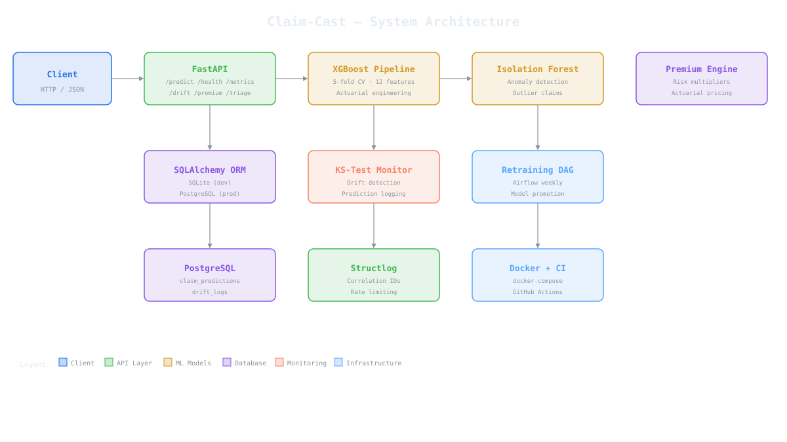

# Claim-Cast

> Insurance claim severity prediction and triage scoring API with XGBoost ensemble, actuarial feature engineering, Isolation Forest anomaly detection, and KS-test drift monitoring.

[](https://github.com/atharvadevne123/reflective-lantern/actions)


---

## Overview

Claim-Cast is a production-ready ML API for insurance claim severity prediction and automated triage. It uses an XGBoost ensemble trained on actuarial features (claim age tiers, severity ratios, frequency flags, geo risk, policy tenure) to classify incoming claims into four severity levels: **low**, **medium**, **high**, and **critical**. An Isolation Forest model runs in parallel to flag anomalous claims. Claims are assigned a triage priority (P1–P4) with SLA-driven response targets.

A KS-test drift monitor checks the distribution of live prediction scores against a reference population, logging alerts to PostgreSQL. A weekly Airflow-compatible retraining DAG automatically refreshes the model when new labeled data is available.

---

## Architecture



| Component | Technology |
|-----------|-----------|
| API framework | FastAPI + Uvicorn |
| ML model | XGBoost (5-fold CV, 12 actuarial features) |
| Anomaly detection | Isolation Forest |
| Feature pipeline | sklearn Pipeline + StandardScaler |
| Drift monitoring | KS-test (scipy) |
| Database | SQLAlchemy + SQLite (dev) / PostgreSQL (prod) |
| Retraining | Airflow-compatible DAG |
| Containerization | Docker + docker-compose |
| CI | GitHub Actions (ruff + pytest) |

---

## Quick Start

```bash
# 1. Clone and install
git clone https://github.com/atharvadevne123/reflective-lantern
cd reflective-lantern/claim-cast
pip install -r requirements.txt

# 2. Copy env template
cp .env.example .env

# 3. Run the API
uvicorn app.main:app --reload
```

Or with Docker:
```bash
docker-compose up --build
```

---

## API Reference

### POST `/api/v1/predict`
Predict claim severity and assign triage priority.

```bash
curl -X POST http://localhost:8000/api/v1/predict \
  -H "Content-Type: application/json" \
  -d '{
    "claim_id": "CLM-2026-001",
    "claim_age_days": 15,
    "policy_limit": 100000,
    "claimed_amount": 45000,
    "num_prior_claims": 2,
    "policy_tenure_years": 4.5,
    "geo_risk_tier": 3.5,
    "days_since_last_claim": 180,
    "policy_type": "auto"
  }'
```

**Response:**
```json
{
  "claim_id": "CLM-2026-001",
  "severity_class": 2,
  "severity_label": "high",
  "severity_score": 0.7231,
  "probabilities": {"low": 0.05, "medium": 0.18, "high": 0.72, "critical": 0.05},
  "anomaly_flag": 0,
  "triage_priority": 2,
  "model_version": "1.0.0"
}
```

### POST `/api/v1/premium`
Compute risk-adjusted premium based on triage result.

### GET `/api/v1/drift`
Run KS-test drift detection on live prediction scores.

### GET `/api/v1/metrics`
Model performance metrics and prediction statistics.

### GET `/api/v1/health`
Liveness and readiness probe.

### GET `/api/v1/triage/{1-4}`
Triage priority SLA and action description.

---

## Triage Priority System

| Priority | Label | SLA | Action |
|----------|-------|-----|--------|
| P1 | Critical / Anomaly | 4h | Senior adjuster assignment |
| P2 | High | 24h | Same-day adjuster |
| P3 | Medium | 72h | Standard queue |
| P4 | Low | 7 days | Automated fast-track |

---

## Feature Engineering

12 actuarial features are derived from raw claim attributes:

| Feature | Description |
|---------|-------------|
| `severity_ratio` | Claimed amount / policy limit |
| `log_claimed` | Log-transformed claimed amount |
| `age_tier` | Claim age buckets (0–7d, 7–30d, 30–90d, 90–365d, >365d) |
| `prior_claim_rate` | Prior claims / policy tenure years |
| `high_frequency_flag` | ≥3 prior claims on this policy |
| `recency_flag` | Last claim < 90 days ago |
| `sev_age_interaction` | severity_ratio × age_tier interaction |
| `policy_type_enc` | Home/auto/life/commercial encoding |
| `geo_risk` | Geographic risk tier (1–5) |
| `days_since_last_claim` | Days since previous claim |
| `log_policy_limit` | Log-transformed policy limit |
| `claim_age_days` | Days from incident to report |

---

## Tests

```bash
make test
# 45 tests: test_api (12), test_model (7), test_features (9), test_monitoring (7)
```

---

## Deployment

```bash
# Production with PostgreSQL
DATABASE_URL=postgresql://user:pass@db:5432/claimcast docker-compose up
```

The retraining DAG can be imported into Airflow:
```bash
cp pipelines/retrain_dag.py $AIRFLOW_HOME/dags/
```

---

## Additional Endpoints

| Method | Path | Description |
|--------|------|-------------|
| POST | `/api/v1/predict/batch` | Batch predict up to 50 claims |
| GET | `/api/v1/claims/stats` | Severity breakdown statistics |
| GET | `/api/v1/feature-importance` | XGBoost feature importance scores |
| POST | `/api/v1/retrain` | Trigger background model retraining |
