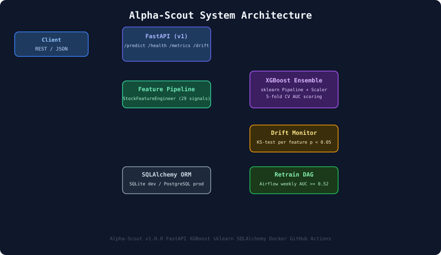

# Alpha-Scout

[](https://github.com/atharvadevne123/Alpha-Scout/actions/workflows/ci.yml)
[](https://python.org)
[](https://fastapi.tiangolo.com)
[](https://xgboost.readthedocs.io)

**ML-powered portfolio alpha generation system.** Alpha-Scout scores securities on 20+ technical and fundamental signals, predicts stock return potential, ranks portfolios, and serves real-time allocation recommendations via a FastAPI REST API.

## Overview

Alpha-Scout ingests OHLCV (open/high/low/close/volume) data for individual securities, engineers a rich feature set covering momentum, volatility, mean-reversion and fundamental factors, then scores each security with an XGBoost ensemble trained on 5-fold cross-validated historical patterns. Each prediction is logged to a database, and a continuous KS-test drift monitor alerts when input distributions shift.

## Architecture



| Layer | Technology |
|-------|-----------|
| API | FastAPI + Uvicorn (3+ endpoints, OpenAPI docs) |
| ML Model | XGBoost + sklearn Pipeline + 5-fold CV |
| Features | 20+ signals: RSI, MACD, rolling stats, momentum lags, ratios |
| Monitoring | KS-test drift detection, prediction logging |
| Persistence | SQLAlchemy ORM (SQLite dev / PostgreSQL prod) |
| Infrastructure | Docker + docker-compose + PostgreSQL |
| CI/CD | GitHub Actions (ruff lint + pytest) |
| Retraining | Airflow-compatible DAG (weekly schedule) |

## Quick Start

```bash
git clone https://github.com/atharvadevne123/Alpha-Scout
cd Alpha-Scout
cp .env.example .env
pip install -r requirements.txt
uvicorn app.main:app --reload
```

API docs available at `http://localhost:8000/docs`

### Docker

```bash
docker-compose up --build
```

## API Reference

### POST `/api/v1/predict`

Score a security and get an alpha score.

**Request:**
```json
{
  "ticker": "AAPL",
  "close": 180.0,
  "open": 179.5,
  "high": 181.2,
  "low": 178.9,
  "volume": 5000000,
  "pe_ratio": 28.5,
  "market_cap": 2900000000000
}
```

**Response:**
```json
{
  "ticker": "AAPL",
  "alpha_score": 72.4,
  "return_prediction": 0.224,
  "confidence": 0.724,
  "model_version": "1.0.0",
  "prediction_id": 42
}
```

`alpha_score` ranges from 0-100 where higher values indicate stronger buy signals.

### GET `/api/v1/health`

Returns service health: model loaded status, DB connectivity.

### GET `/api/v1/metrics`

Returns aggregate prediction statistics over the last 100 predictions.

### POST `/api/v1/drift`

Run a KS-test drift check for any named feature distribution.

### POST `/api/v1/rank`

Rank a list of securities by alpha score. Highest alpha_score = rank 1.

### GET `/api/v1/feature-importance`

Returns top 10 feature importances from the XGBoost model.

### POST `/api/v1/anomaly`

Detect anomalous input features via Isolation Forest.

### GET `/api/v1/pipeline-health`

Diagnostics for the loaded ML pipeline (fitted check, predict_proba availability).

## Feature Engineering

`StockFeatureEngineer` computes 29 features per row:

| Category | Features |
|----------|---------|
| Momentum (lags) | `return_lag_{1,3,5,10,20}` |
| Rolling stats | `mean/std/max/min_{5,10,20}` |
| Price ratios | `price_to_ma5`, `price_to_ma20`, `high_low_ratio` |
| Volume | `volume_ratio` |
| Volatility | `volatility_{5,20}` |
| Technical | `rsi_14`, `macd`, `macd_signal`, `macd_hist` |
| Fundamental | `pe_ratio`, `log_market_cap` |

## Running Tests

```bash
make test
# or
pytest tests/ -v
```

## Retraining

```bash
python -c "from pipelines.retrain_dag import run_pipeline; run_pipeline()"
```

The pipeline trains on 5-ticker synthetic OHLCV data with 5-fold CV, validates AUC >= 0.52, and saves the model.

## Environment Variables

See `.env.example` for all configuration options.

## Contributing

See [CONTRIBUTING.md](CONTRIBUTING.md).

## Changelog

See [CHANGELOG.md](CHANGELOG.md).

## Model Quality

| Metric | Value |
|--------|-------|
| Algorithm | XGBoost Classifier |
| Cross-validation | 5-fold stratified |
| Scoring | ROC-AUC |
| Features | 29 engineered signals |
| Training tickers | 5 synthetic OHLCV series |
