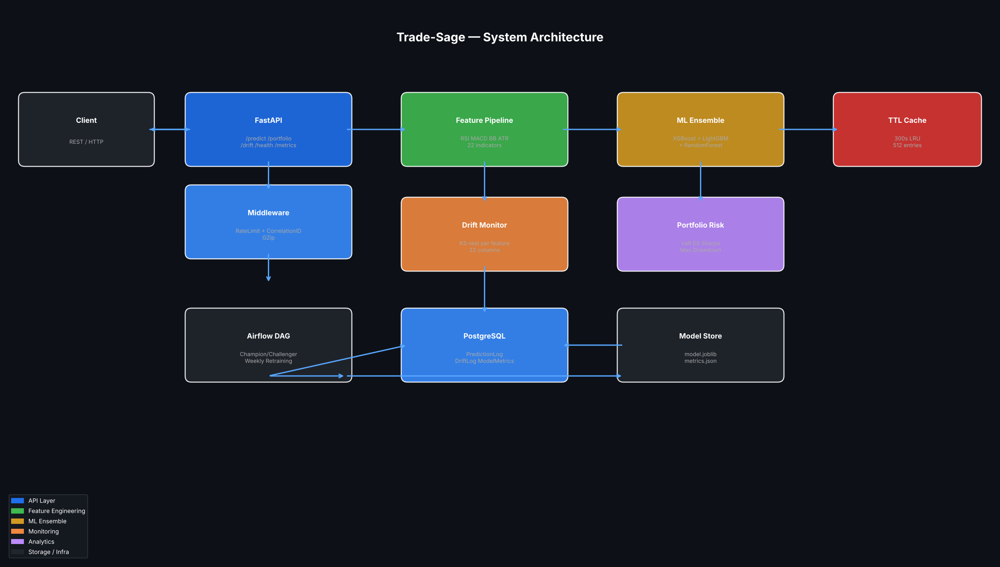

# Trade-Sage

[](https://github.com/atharvadevne123/reflective-lantern/actions)
[](https://python.org)
[](LICENSE)

> **Equity trading signal prediction and portfolio risk scoring API** using an XGBoost-LightGBM-RandomForest ensemble over 22 technical indicator features, KS-test drift monitoring, and automated champion/challenger retraining.

---

## Overview

Trade-Sage is a production-quality FastAPI service that:

- **Predicts directional signals** (BUY/SELL) from OHLCV price history using a soft-voting ensemble trained on 22 engineered technical indicators
- **Scores portfolio risk** with VaR, Expected Shortfall, Sharpe ratio, and maximum drawdown analytics
- **Monitors feature drift** using KS-tests on all 22 input features and logs alerts to PostgreSQL
- **Self-retrains** via an Airflow champion/challenger DAG that only promotes a challenger model when its AUC exceeds the current champion

## Architecture



## Features

| Category | Details |
|---|---|
| **ML Model** | XGBoost + LightGBM + RandomForest soft-voting ensemble |
| **Features** | RSI, MACD, Bollinger Bands, ATR, volume ratio, 5 lag returns, rolling volatility, SMA ratios, momentum, spread, range, price position (22 total) |
| **CV** | 5-fold stratified AUC-ROC |
| **Drift** | KS-test per feature; results logged to `drift_logs` |
| **Portfolio** | Historical VaR, CVaR/ES, annualised Sharpe, max drawdown |
| **Cache** | Thread-safe TTL/LRU (300s, 512 entries) |
| **Rate limiting** | 200 req/min per IP |
| **API** | 6 versioned endpoints under `/api/v1/` |
| **Retraining** | Airflow DAG, weekly, champion/challenger with AUC gate |
| **DB** | SQLite (dev) / PostgreSQL (prod) via SQLAlchemy + Alembic |

## Quick Start

```bash
# Clone and install
git clone https://github.com/atharvadevne123/reflective-lantern
cd reflective-lantern/trade-sage
pip install -r requirements.txt
cp .env.example .env

# Run locally
uvicorn app.main:app --reload --port 8000

# Or via Docker
docker-compose up
```

## API Reference

### `POST /api/v1/predict`

Predict directional equity signal from OHLCV history.

```json
{
  "ticker": "AAPL",
  "horizon_days": 5,
  "ohlcv": [
    {"open": 150.0, "high": 152.5, "low": 149.0, "close": 151.2, "volume": 5000000},
    "... (at least 60 rows, oldest first)"
  ]
}
```

**Response:**
```json
{"ticker": "AAPL", "prediction": 1, "confidence": 0.73, "horizon_days": 5, "signal": "BUY"}
```

### `POST /api/v1/portfolio/risk`

Compute portfolio risk metrics from holdings.

```json
{
  "holdings": [
    {"ticker": "AAPL", "weight": 0.6, "ohlcv": [...]},
    {"ticker": "GOOG", "weight": 0.4, "ohlcv": [...]}
  ],
  "confidence_level": 0.95
}
```

### `POST /api/v1/drift`

Check feature drift on a recent OHLCV window against the reference distribution.

### `GET /api/v1/health`

Service health and model readiness.

### `GET /api/v1/metrics`

Runtime counters: predictions, drift alerts, model AUC, uptime.

### `POST /api/v1/train`

Trigger a training run (demo synthetic data — replace with real source in production).

## Feature Engineering Pipeline

```
OHLCV input (N×5)
    ↓ TechnicalIndicators   → RSI, MACD, MACD Signal, MACD Hist, BB%B, BB Width, ATR, Vol Ratio (8)
    ↓ LagRollingFeatures    → 1/2/3/5/10d returns, 5/20d volatility, SMA ratios, momentum (11)
    ↓ RatioFeatures         → OC spread, HL range, price position (3)
    = 22 features → StandardScaler → VotingClassifier
```

## Running Tests

```bash
make test
# or
pytest tests/ -v
```

75 tests across 6 modules: features, model, API endpoints, portfolio analytics, monitoring, validation.

## Development

```bash
make lint-fix   # ruff autofix
make test       # pytest
make build      # wheel
```

## Docker

```bash
docker-compose up -d
curl http://localhost:8000/api/v1/health
```

## Data Note

No proprietary market data ships with this repo. The `/api/v1/train` endpoint generates synthetic OHLCV-style data for demonstration. In production, replace with real data via a market data provider (e.g., yfinance, Polygon, Alpaca).
